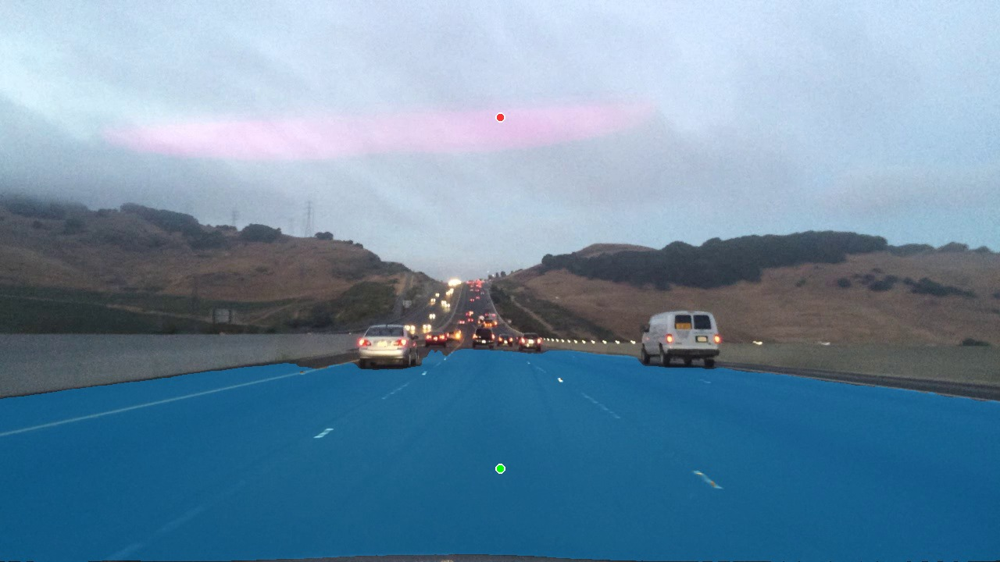

# Báo cáo tích hợp MobileSAM vào CVAT local

Ngày kiểm chứng: **12/11/2026, UTC+7**. Mã triển khai: [integrations/cvat-sam](../../integrations/cvat-sam/README.md). Phần tích hợp được xây dựng với sự hỗ trợ của Codex; các số liệu dưới đây lấy từ phép chạy thực tế trên máy local.

## Mục tiêu và cách tích hợp

Chọn nhãn trong CVAT, chấm point dương bên trong vật/vùng cần lấy và thêm point âm để loại vùng thừa. MobileSAM tạo mask gợi ý; người gán nhãn kiểm tra, chỉnh sửa và xác nhận trước khi Save. Model không tự phân loại hoặc tự chạy gán nhãn toàn bộ task.

Đã triển khai function **`pth-mobilesam-local`**, tên hiển thị **MobileSAM Local (points)**, loại `interactor`, giao thức `version: 2`, một worker. Function trả mask CVAT RLE có bbox inclusive, giữ được lỗ và vùng rời. Một predictor giữ embedding của một ảnh đang thao tác để tránh mã hóa lại khi thêm point trên cùng ảnh.

Luồng thực tế: CVAT -> Nuclio -> MobileSAM encoder và decoder trên máy local -> mask CVAT có thể chỉnh sửa. Adapter dùng ID riêng, không thay mã UI/decoder SAM của CVAT. Cấu hình Nuclio được bổ sung bằng Compose override trong repo, không chỉnh Compose gốc hay xóa Docker volumes. Bản triển khai GPU đã được chạy; cấu hình CPU dự phòng có trong mã nhưng chưa được benchmark riêng.

## Môi trường

| Thành phần | Cấu hình đã kiểm chứng |
| --- | --- |
| CVAT | Community v2.74.1, Docker Desktop / WSL2 |
| GPU | NVIDIA GeForce MX250, 2048 MiB VRAM |
| CPU / RAM máy | i5-10210U, 4 nhân / 8 luồng; khoảng 12 GB RAM |
| Model | MobileSAM `vit_t`, checkpoint 40,728,226 bytes |
| PyTorch / torchvision | 2.5.1+cu118 / 0.20.1+cu118 |
| CUDA runtime của model | 11.8 |
| Nuclio | 1.16.3 |

Nguồn model được cố định tại commit `f706ad9c4eb7f219c00d9050e46328518ffb65d2`. Checkpoint SHA256: `6dbb90523a35330fedd7f1d3dfc66f995213d81b29a5ca8108dbcdd4e37d6c2f`. Script tải và Dockerfile đều kiểm checksum. Xem [nguồn và giấy phép](../../integrations/cvat-sam/README.md#nguồn-và-giấy-phép).

## Kết quả thực nghiệm

Ảnh: `data/tiers/easy_semantic/images/7ee6d192-89e2408b.jpg`, kích thước **1280 × 720**. Phép thử HTTP trực tiếp dùng point dương **(640, 600)** trên mặt đường, point âm **(640, 150)** trên trời. Năm request cùng ảnh và cùng tập point; đây là phép đo cache và độ trễ, không phải năm object được gán nhãn.

| Phép đo | Kết quả quan sát |
| --- | --- |
| HTTP đến Nuclio, lần suy luận đầu sau khi function khởi động | **11.062 giây** |
| HTTP đến Nuclio, bốn lần sau với embedding có cache | **0.494–0.760 giây / request** |
| CVAT APIClient, thêm point âm trên ảnh có cache | **0.381 giây** |
| CVAT APIClient, gọi lại tập point có cache | **0.542 giây** |
| CVAT APIClient, ROI mới, gồm tính embedding mới | **0.675 giây** |
| Peak bộ nhớ tensor PyTorch cấp phát trong các phép thử | **291.14 MiB** |
| Peak bộ nhớ PyTorch reserved trong các phép thử | **400 MiB** |
| Snapshot `nvidia-smi` sau suy luận | **449 MiB dùng / 2048 MiB tổng** |
| Snapshot RAM container function sau suy luận | Khoảng **761.9 MiB** |

Số liệu PyTorch không bao gồm toàn bộ chi phí GPU/driver; snapshot `nvidia-smi` là quan sát tại một thời điểm, không phải peak VRAM được theo dõi liên tục. RAM container model không bao gồm các service khác của CVAT. Kết quả chứng minh cấu hình này chạy được phép thử trên MX250 2 GB; không cam kết mọi độ phân giải hoặc nhiều người dùng đồng thời có cùng mức tài nguyên.

Thời gian CVAT APIClient đi qua view/kiểm tra quyền OPA/gateway thực và HTTP tới Nuclio, nhưng test client chạy trong tiến trình Django nên không bao gồm trình duyệt và HTTP từ trình duyệt tới CVAT. Lần đầu CVAT còn chuẩn bị image chunk; không dùng nó làm số đo độ trễ ổn định.

- [JSON HTTP gốc](evidence/nuclio-http-smoke-test.json)
- [CSV năm lần đo HTTP](measurements.csv)
- [JSON kiểm chứng CVAT](evidence/cvat-api-verification.json)

## Minh chứng mask

Ảnh dưới là **overlay dựng từ kết quả inference thật**, không phải ảnh chụp giao diện CVAT. Chấm xanh là point dương, chấm đỏ là point âm; vùng xanh lam là mask model trả về. Mask này là gợi ý chưa qua duyệt bài, không phải ground truth.

## Những kiểm tra đã đạt

- **5 unit tests**: RLE round-trip giữ lỗ/vùng rời/biên; bbox inclusive; mask crop không lệch; mask rỗng không tạo object; point không hợp lệ bị từ chối.
- CVAT liệt kê đúng function, loại `interactor`, hỗ trợ point dương và âm.
- **4 lượt gọi qua CVAT** trên task `easy_semantic`, task ID **3**, job ID **3**, frame **0**: point dương; thêm point âm; lặp ảnh có cache; ROI và dịch tọa độ về ảnh gốc. Tất cả trả HTTP 200 và mask có bbox hợp lệ.
- Hash annotation của task trước/sau phép thử giống nhau: `3d70bd41f9118eb69d000379fe47021c3bb214073d5094c558cb4e5eef117629`. Phép thử không lưu annotation, không tạo ZIP bài nộp và không thay các mask đang có.
- Endpoint CVAT `/api/server/about` trả HTTP 200, version 2.74.1; endpoint model trả `ready`, device `cuda` và GPU MX250.

Công cụ điều khiển trình duyệt không xác định được URL Chrome nên đã dừng; **chưa kiểm chứng thao tác click/xác nhận/Save trong trình duyệt**. Bằng chứng hiện tại là test model, Nuclio và backend CVAT thực. Sau khi dùng công cụ trong job, người học có thể bổ sung ảnh chụp thao tác và ZIP export của chính bài làm.

## Đánh giá năng suất và giới hạn

Cache giảm độ trễ kỹ thuật trên cùng ảnh, phù hợp với việc thêm point để sửa mask. Mục tiêu của công cụ là giảm thao tác vẽ toàn bộ biên bằng tay. **Chưa đo thời gian vẽ tay so với dùng SAM, chưa kết luận phần trăm tăng năng suất.** Confidence của model không phải mIoU hoặc điểm bài làm; chưa đối chiếu ground truth trong phép thử này.

Để bổ sung đánh giá năng suất sau khi sử dụng thực tế, ghi thời gian vẽ tay và thời gian dùng SAM (bao gồm chỉnh sửa) trên các object có độ khó tương đương, cùng điều kiện zoom và quy tắc gán nhãn. Giữ các trường hợp SAM tràn biên/bỏ vùng và cách sửa. Object đầu tiên ở Medium vẫn tự vẽ trước gợi ý theo `RULES.md`.

Rubric hiện tại chưa có bonus riêng cho SAM. Minh chứng này trình bày cách triển khai và kết quả kỹ thuật; chất lượng mask, đủ vật, đúng lớp và giải thích quyết định vẫn là nội dung chính của bài nộp.
